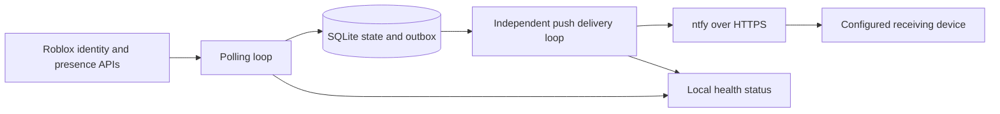

# Design

## Data flow

One Python process, two threads, one local SQLite file. The polling thread validates the observer's identity on each cycle and reads only the specified target's presence. The delivery thread handles durable notifications, independent of source latency. Both use bounded HTTP responses and socket timeouts. The systemd watchdog detects a stalled main loop; the main loop detects a stalled delivery worker. A process lock prevents two workers using the same state directory.

## State and failure rules

| Observation | Effect |
| --- | --- |
| First known online | One online alert, unless silent startup is selected |
| Offline to online | One new session and one alert |
| Online to in-game/in-studio/online | Same session; no additional alert |
| First offline sample during an online session | Hold the current session, pause any unsent online alert |
| Second consecutive valid offline sample | Mark offline, cancel unsent online alerts, rearm |
| Missing target, unsupported enum, malformed reply, auth or network failure | Unknown; keep confirmed state and reset offline confirmation |
| Long gap between valid samples | Reset offline confirmation so disconnected samples are not treated as consecutive |
| Process restart | Restore confirmed state, pending outbox, and provider backoff; do not fabricate a transition |

State is scoped to observer and target IDs. Transition and outbox insertion share a SQLite transaction with WAL and full synchronous commits. Outbox entries expire and completed entries are pruned after seven days. A future unknown database version is refused rather than erased.

Push success requires a structured acknowledgement from the selected provider, not just HTTP 200. Push payloads omit Roblox account names/IDs and game information; online alerts link to Roblox's home page rather than an identifying profile URL. Source and push retries have separate exponential backoff. A provider's `Retry-After` is a minimum; its retry barrier is persisted and applies to all new events. Errors logged by the monitor use fixed codes only. Arbitrary HTTP bodies, URLs, exception strings, and cookies are never logged.

Roblox may rotate `.ROBLOSECURITY` through `Set-Cookie`. The transport preserves
all such headers. The source only adopts rotation after the observer identity is
verified, on a bounded CSRF retry, or after a valid presence result. It retains
only `.ROBLOSECURITY`, rejects invalid values/domains/deletion, and atomically
saves the current value in a mode-0600 state file. Subsequent polls and restarts
use it; the installer exports the current value rather than an invalidated source.
A changed source credential overrides an older cache. The cached value belongs
to the source fingerprint consumed by the request, so a concurrent manual refresh
does not accidentally adopt an older request's rotation for the new source.
The state directory is therefore also credential storage and must stay private.

Online delivery requires a recent successful observation in the same session with no outstanding source error. A message can still arrive after an account has just gone offline: observations and network delivery cannot be atomic with Roblox. It therefore says when the state was observed. Alerts that cannot be delivered within five minutes expire rather than misleadingly announcing an old session.

Monitoring outages produce an alert after the configured threshold at the next failed check. Recovery produces a recovery message. If the internet or notification service is down, an outage alert cannot be guaranteed to reach the phone; the local `status` command exposes the failure. A working provider acknowledgement proves acceptance, not Android receipt.

## Deployment isolation

The optional systemd deployment reserves these paths:

- `/opt/roblox-presence/releases/0.1.0` and its `current` symlink: source code.
- `/etc/roblox-presence`: root-only configuration and credential sources.
- `/var/lib/roblox-presence`: systemd-managed persistent state.
- `/etc/systemd/system/roblox-presence.service`: this service's unit.

The systemd example has a dynamic unprivileged identity, read-only system/home access, private temporary/device access, no capabilities, no explicit socket binds, a 5% CPU quota, a 128 MiB memory limit, and at most 16 tasks. Other supervisors need their own equivalent isolation configuration. The runtime makes outbound TLS requests only, without inheriting proxy settings. HTTPS redirects are refused so credentials cannot be forwarded to an unexpected host. Roblox URLs are fixed; ntfy's HTTPS origin is configurable.

Systemd `LoadCredential` exposes the cookie and topic through restricted credential files. Foreground/OpenRC deployment can instead use absolute paths to protected files accessible only to the dedicated runtime account. Configuration stores references, not secret values. Reloading root credential source files does not update an already-running systemd credential snapshot: restart only this monitor after rotation. Session lifetime depends on Roblox; the monitor cannot guarantee a login will remain valid indefinitely.

## Acceptance gates

1. Authenticated observer ID equals the configured observer's ID.
2. Target ID resolves to the intended account.
3. Authenticated presence matches manual Roblox visibility during a known online session, then observes an offline to online transition.
4. The configured device receives the test promptly while locked/idle and on the intended networks.
5. Restarting this monitor does not resend the same already-observed session.
6. Other services on the host remain running and unchanged.

The automated tests cover software failure rules. Gates 3 and 4 require real account and phone verification; fixture tests cannot prove them.
