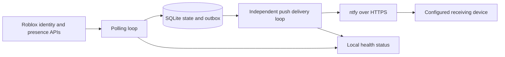

# Design

## Data flow

One Python process, two threads, one local SQLite file. The polling thread validates the observer's identity on each cycle and reads only the specified target's presence. The delivery thread handles durable notifications, independent of source latency. Both use bounded HTTP responses and socket timeouts. The systemd watchdog detects a stalled main loop; the main loop detects a stalled delivery worker. A process lock prevents two workers using the same state directory.

## State and failure rules

| Observation | Effect |
| --- | --- |
| First known online | One online alert, unless silent startup is selected |
| Offline to online | One new session and one alert |
| Online to in-game/in-studio/online | Same session; no additional alert |
| First offline sample during an online session | Hold the current session, pause any unsent online alert |
| Second consecutive valid offline sample | Mark offline, cancel unsent online alerts, rearm |
| Missing target, unsupported enum, malformed reply, auth or network failure | Unknown; keep confirmed state and reset offline confirmation |
| Long gap between valid samples | Reset offline confirmation so disconnected samples are not treated as consecutive |
| Process restart | Restore confirmed state, pending outbox, and provider backoff; do not fabricate a transition |

State is scoped to observer and target IDs. Transition and outbox insertion share a SQLite transaction with WAL and full synchronous commits. Outbox entries expire and completed entries are pruned after seven days. A future unknown database version is refused rather than erased.

Push success requires a structured acknowledgement from the selected provider, not just HTTP 200. Push payloads include the player’s display name, username, visible game description and server-local observation time. They omit credentials and numeric account/place/server IDs; alerts link to Roblox’s home page. Game descriptions come only from type-2 presence `lastLocation`; no hidden game lookup is attempted. A public profile lookup is cached for an hour, with a bounded retry floor on failure, and cannot invalidate an otherwise valid presence result. One first-game follow-up per online session is durable across restarts; unsent online alerts are enriched instead when possible. Source and push retries have separate exponential backoff. A provider's `Retry-After` is a minimum; its retry barrier is persisted and applies to all new events. Errors logged by the monitor use fixed codes only. Arbitrary HTTP bodies, URLs, exception strings, and cookies are never logged.

Roblox may rotate `.ROBLOSECURITY` through `Set-Cookie`. The transport preserves
all such headers. The source only adopts rotation after the observer identity is
verified, on a bounded CSRF retry, or after a valid presence result. It retains
only `.ROBLOSECURITY`, rejects invalid values/domains/deletion, and atomically
saves the current value in a mode-0600 state file. Subsequent polls and restarts
use it; the installer exports the current value rather than an invalidated source.
A changed source credential overrides an older cache. The cached value belongs
to the source fingerprint consumed by the request, so a concurrent manual refresh
does not accidentally adopt an older request's rotation for the new source.
The state directory is therefore also credential storage and must stay private.

Online delivery requires a recent successful observation in the same session with no outstanding source error. A message can still arrive after an account has just gone offline: observations and network delivery cannot be atomic with Roblox. It therefore says when the state was observed. Alerts that cannot be delivered within five minutes expire rather than misleadingly announcing an old session.

Monitoring outages produce an alert after the configured threshold at the next failed check. Recovery produces a recovery message. If the internet or notification service is down, an outage alert cannot be guaranteed to reach the phone; the local `status` command exposes the failure. A working provider acknowledgement proves acceptance, not Android receipt.

## Deployment isolation

The optional systemd deployment reserves these paths:

- `/opt/roblox-presence/releases/0.2.1` and its `current` symlink: source code.
- `/etc/roblox-presence`: root-only configuration and credential sources.
- `/var/lib/roblox-presence`: systemd-managed persistent state.
- `/etc/systemd/system/roblox-presence.service`: this service's unit.

The systemd example has a dynamic unprivileged identity, read-only system/home access, private temporary/device access, no capabilities, no explicit socket binds, a 5% CPU quota, a 128 MiB memory limit, and at most 16 tasks. Other supervisors need their own equivalent isolation configuration. The supervised monitoring worker makes outbound TLS requests only, without inheriting proxy settings. HTTPS redirects are refused so credentials cannot be forwarded to an unexpected host. Roblox URLs are fixed; ntfy's HTTPS origin is configurable.

Systemd `LoadCredential` exposes the cookie and topic through restricted credential files. Foreground/OpenRC deployment can instead use absolute paths to protected files accessible only to the dedicated runtime account. Configuration stores references, not secret values. Reloading root credential source files does not update an already-running systemd credential snapshot: restart only this monitor after rotation. Session lifetime depends on Roblox; the monitor cannot guarantee a login will remain valid indefinitely.

## Acceptance gates

1. Authenticated observer ID equals the configured observer's ID.
2. Target ID resolves to the intended account.
3. Authenticated presence matches manual Roblox visibility during a known online session, then observes an offline to online transition.
4. The configured device receives the test promptly while locked/idle and on the intended networks.
5. Restarting this monitor does not resend the same already-observed session.
6. Other services on the host remain running and unchanged.

The automated tests cover software failure rules. Gates 3 and 4 require real account and phone verification; fixture tests cannot prove them.

## Activity history and reports

Schema 2 adds a bounded presence sample table and notification metadata. Migration from schema 1 runs in an explicit atomic transaction and is additive: session IDs, pending acknowledgements, and provider backoff are preserved. Each successful poll records online/offline/pending; failed polls record unknown. Confirmed logout events refer to the first consecutive offline check and separately retain the confirmation time. Pending offline samples become offline only after confirmation; an interruption breaks that chain. Initial states are labeled “first seen,” not an inferred login/logout. Retention is fifteen elapsed days, pruned on the existing maintenance schedule.

The report reads a consistent, read-only SQLite snapshot for fourteen server-local dates. It does not load any credentials, poll Roblox, change state, or make HTTP requests. It draws no continuous known span across failed/pending samples or a gap exceeding the freshness threshold. It does not extrapolate after the last recorded check. Session activity during gaps remains unknown even if stable alert state persists across a restart.

Clock times are rendered on the host with its timezone database, using historical offsets, seconds, timezone abbreviations, and UTC offsets. A 23- or 25-hour local date has its own axis; repeated clock hours show different offsets in the event table. The browser receives preformatted times and never converts them to its own zone. Correct system time and timezone configuration are the administrator’s responsibility; the application does not change them or infer physical location.

HTML is self-contained, uses escaped and bounded API text, contains no credentials/topic, and applies a restrictive content security policy. Export is atomic, mode 0600, and owned by the invoking user (the original sudo user when applicable). Unsafe output types/owners and writable shared parent folders are refused. Existing report copies are outside database retention; operators must delete them when no longer wanted.

The installer reserves `/usr/local/bin/roblox` and `/usr/local/bin/robox` as links to its launchers, refusing unrelated command collisions. Upgrade leaves the service unit and credential files unchanged, takes a private SQLite backup while this monitor is stopped, switches its release link, and starts only this unit. After activation it never automatically restores an old database, which could erase new acknowledgements and replay notifications. Preserve state/backups and inspect a failed upgrade.

Root report/backup operations preserve ownership of any SQLite WAL sidecars so diagnostics cannot lock the unprivileged worker out of its state. Report queries remain read-only SQL.

## Temporary browser links

`graph` now starts an independent, temporary single-report HTTP viewer after
saving its private HTML. `--file-only` starts no viewer and prints a valid escaped
file URI. No change to the monitoring unit or its bind prohibition is required.
The viewer defaults to loopback; `graph_listen_address` or `--listen` must select
a specific RFC1918 IPv4 or IPv6 unique-local address for other devices. Public,
all-interface, scoped and hostname binds are refused. No address is autodetected
or published, and the application does not change firewall/proxy/network setup.

A fresh 256-bit random path grants access to one in-memory snapshot for ten
minutes by default (maximum sixty). No directory/file lookup or access logging is
performed. Only GET/HEAD at the exact token path with an allowed Host succeeds;
other paths, expired tokens, foreign hosts and write requests disclose no report.
Responses prohibit caching, referrers and framing. The existing HTML CSP still
applies. A single request is processed at a time with socket timeouts, bounded
request churn and lower process priority. Expiry or Ctrl+C closes the socket.

A root graph invocation drops supplementary groups, GID and UID to the original
sudo caller before binding. Root-only terminals must use `--file-only` or invoke
through a regular user's sudo session. The viewer never loads session cookies or
notification secrets. HTTP is not encryption: non-loopback links are for trusted
private networks or an existing encrypted SSH/VPN path, not public hosting.
Closing a viewer leaves monitoring, its database and its saved report intact.
The optional upgrade `--graph-listen` backs up and atomically updates only this
monitor's configuration before restarting its unit with the new source.
